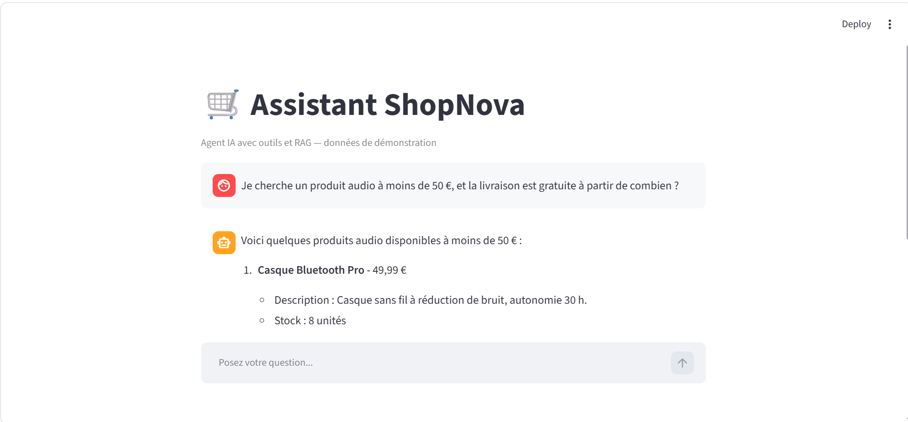

# 🛒 ShopNova — Agent IA de support client (outils + RAG)

> Projet personnel d'apprentissage.
> ShopNova est une boutique en ligne **fictive** : toutes les données (produits, commandes, documents) sont des **données de démonstration**.

ShopNova est un **agent IA de support client** pour une boutique en ligne. Il répond aux clients en français, consulte les **données de la boutique** grâce à des **outils** (function calling), et répond aux questions sur les **règles de la boutique** grâce à un **RAG** sur des documents internes. L'agent est exposé par une **API FastAPI**, utilisée par une interface **Streamlit**. Des **garde-fous** dans le code protègent les données des clients et les règles de la boutique.



---

## ✨ Fonctionnalités

| Le client demande… | L'agent utilise… |
|---|---|
| « Avez-vous des casques ? » | 🔍 `chercher_produit` |
| « Où est ma commande CMD1003 ? » | 📦 `suivre_commande` (numéro + email du client) |
| « Un produit audio à moins de 40 € ? » | 💡 `recommander` |
| « Je veux retourner ma commande CMD1001 » | ↩️ `creer_retour` (numéro + email + motif) |
| « J'ai combien de jours pour un retour ? » | 📚 `chercher_dans_documents` (RAG) |

- **Agentic RAG** : l'agent choisit lui-même entre les outils (données précises : produits, commandes) et le RAG (règles : retours, livraison, garantie, FAQ).
- **Citation des sources** : les réponses issues des documents indiquent leur origine.
- **API REST (FastAPI)** : route `POST /chat`, validation des entrées et sorties avec **Pydantic** (requête invalide → erreur 422), une conversation par client grâce à un `session_id`.
- **Mémoire de conversation** : l'historique de chaque session est renvoyé au modèle à chaque appel.
- **Gestion des erreurs** : si un outil échoue, l'erreur est renvoyée au modèle, qui l'explique au client ; si l'API est injoignable, l'interface affiche un message clair.

---

## 🛡️ Garde-fous

Principe de **défense en profondeur** : le prompt guide le modèle, mais les règles critiques sont **vérifiées dans le code des outils**, pour qu'elles ne puissent pas être contournées.

| Garde-fou | Où | Test réalisé |
|---|---|---|
| Retour seulement pour une commande **livrée** | code (`creer_retour`) | commande expédiée → refus |
| Retour seulement **dans les 30 jours** après la livraison | code (`creer_retour`) | commande livrée il y a 35 jours → refus, même quand le client insiste |
| Une commande n'est visible que par **son client** (numéro + email) | code (`suivre_commande`, `creer_retour`) | mauvais email → refus, sans aucune donnée personnelle |
| Même message si la commande n'existe pas ou si l'email est faux | code | ne révèle pas l'existence d'une commande |
| Validation des requêtes | API (Pydantic) | message vide → erreur 422, l'agent n'est pas appelé |
| Résistance au **prompt injection** (OWASP LLM Top 10) | prompt système + code | **5 attaques sur 5 bloquées** (révéler le prompt, faux administrateur, « mode développeur », contourner la règle des 30 jours, changer de rôle) |

---

## 🏗️ Architecture

```
👤 Client
   ↓
🖥️ Interface Streamlit                 (frontend/app.py)
   ↓  requête HTTP  POST /chat
⚙️ API FastAPI + Pydantic + sessions   (backend/main.py)
   ↓
🤖 Agent : LLM OpenAI + boucle d'agent  (backend/agent.py)
   ↓                                  ↓
🛠️ Outils Python + garde-fous       📚 RAG
(backend/tools.py)                 (backend/rag.py)
   ↓                                  ↓
📦 Données produits / commandes     🗄️ ChromaDB ← documents Markdown
```

**Choix de conception**
- **Outils pour les données structurées** (prix, stock, commandes) : elles demandent une réponse **exacte et à jour**, ce qu'une recherche sémantique ne garantit pas.
- **RAG pour les documents** (politiques, FAQ) : la recherche par le **sens** permet de retrouver une règle même si le client utilise d'autres mots.
- **Frontend et backend séparés** : l'interface ne connaît pas l'agent, elle appelle l'API ; elle pourrait être remplacée (site web, application mobile) sans modifier le backend.
- **Boucle d'agent codée à la main** (sans framework) pour comprendre le mécanisme du function calling, avant de la migrer vers LangGraph.
- **Découpage des documents par titres Markdown** : chaque chunk correspond à une section complète, avec ses métadonnées (document, section, fichier source).

---

## 📊 Évaluation

**Partie RAG — RAGAS** (`tests/evaluation_ragas.py`)
- Jeu de test : 5 questions sur les règles de la boutique, avec une réponse de référence vérifiée dans les documents.
- Métriques : **faithfulness** (fidélité aux documents) et **answer correctness** (exactitude), avec un LLM comme juge.
- Score de départ : **faithfulness 0,85**, **answer correctness entre 0,68 et 0,72** selon les exécutions.
- Constats : les scores varient d'une exécution à l'autre (modèles non déterministes), et 5 questions ne suffisent pas pour une moyenne fiable. Un score bas venait d'un faux négatif de l'évaluation (le juge ne voyait pas la source citée), corrigé.

**Tests manuels des garde-fous** : voir le tableau ci-dessus.

Le détail de tous les cas est dans [`notes_evaluation.md`](notes_evaluation.md).

---

## 🧰 Technologies

- **Python**
- **OpenAI API** (chat completions + function calling, embeddings `text-embedding-3-small`)
- **LangChain** (découpage des documents)
- **ChromaDB** (base vectorielle)
- **FastAPI** + **Pydantic** (API REST, validation des données)
- **Streamlit** (interface)
- **RAGAS** (évaluation du RAG)

---

## 🚀 Installation

```bash
git clone https://github.com/HanaaMorine/shopnova.git
cd shopnova
python -m venv venv
venv\Scripts\activate          # Windows  (macOS/Linux : source venv/bin/activate)
pip install -r requirements.txt
```

Créer un fichier `.env` à la racine :
```
OPENAI_API_KEY=votre_cle_api
```

Construire la base vectorielle (une seule fois) :
```bash
python backend/rag.py
```

Lancer l'application (**deux terminaux**) :
```bash
# Terminal 1 : l'API
uvicorn main:app --reload --app-dir backend

# Terminal 2 : l'interface
streamlit run frontend/app.py
```

- Interface : http://localhost:8501
- Documentation interactive de l'API (Swagger) : http://127.0.0.1:8000/docs

Lancer l'évaluation RAGAS :
```bash
python tests/evaluation_ragas.py
```

---

## 🧪 Exemples de questions

- « Avez-vous des casques ? »
- « Où est ma commande CMD1003 ? » (email : `emma.dubois@example.com`)
- « Je cherche un produit audio à moins de 40 € »
- « La livraison est gratuite à partir de combien ? »
- « Je veux retourner ma commande CMD1001, le son grésille » (email : `camille.martin@example.com`)
- « Est-ce que vous avez des codes promo ? »

---

## 💡 Ce que j'ai appris en testant

- **Sans outils, le modèle invente** : il affirmait que la boutique vendait des vêtements. Les outils et le RAG ont supprimé ce problème.
- **La description d'un outil guide le choix du modèle** : l'agent ne cherchait pas les codes promo dans la FAQ ; en élargissant la description de l'outil RAG, il a trouvé la bonne réponse.
- **Les règles métier doivent être dans le code**, pas seulement dans le prompt : un modèle peut se tromper ou être manipulé.
- **Une évaluation peut elle-même se tromper** : il faut toujours lire les cas, pas seulement les chiffres.

---

## 🗺️ Prochaines étapes

- [x] Garde-fous : délai de retour de 30 jours, vérification du client, résistance au prompt injection
- [x] Évaluation RAGAS (score de départ)
- [x] API FastAPI + Pydantic, interface reliée à l'API
- [ ] Tests `pytest` (outils, règles métier, API)
- [ ] Outils branchés sur SQLite (les retours sont actuellement gardés en mémoire)
- [ ] Évaluation plus large : 15 à 30 cas, choix des outils, plusieurs exécutions, comparaison avant/après
- [ ] Logs, Docker, GitHub Actions
- [ ] Migration de la boucle d'agent vers LangGraph

---

## ⚠️ Limites connues

- Données fictives.
- Les conversations et les demandes de retour sont gardées en mémoire (perdues au redémarrage de l'API).
- Évaluation sur un petit jeu de test (5 questions).