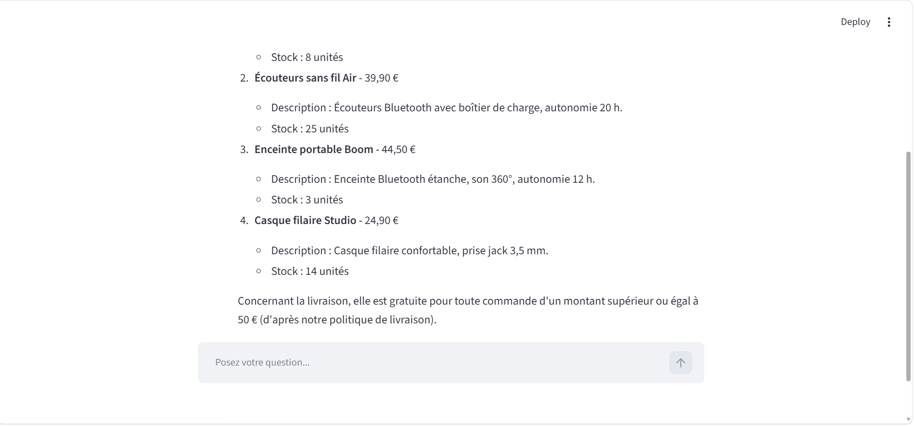

# 🛒 ShopNova — Agent IA de support client (outils + RAG)

> Projet personnel d'apprentissage, **en cours de développement**.
> ShopNova est une boutique en ligne **fictive** : toutes les données (produits, commandes, documents) sont des **données de démonstration**.

ShopNova est un **agent IA de support client** pour une boutique en ligne. Il répond aux clients en français, consulte les **données de la boutique** grâce à des **outils** (function calling), et répond aux questions sur les **règles de la boutique** grâce à un **RAG** sur des documents internes.




---

## ✨ Fonctionnalités

| Le client demande… | L'agent utilise… |
|---|---|
| « Avez-vous des casques ? » | 🔍 `chercher_produit` |
| « Où est ma commande CMD1003 ? » | 📦 `suivre_commande` |
| « Un produit audio à moins de 40 € ? » | 💡 `recommander` |
| « Je veux retourner ma commande CMD1001 » | ↩️ `creer_retour` (avec vérification du statut de la commande) |
| « J'ai combien de jours pour un retour ? » | 📚 `chercher_dans_documents` (RAG) |

- **Agentic RAG** : l'agent choisit lui-même entre les outils (données précises : produits, commandes) et le RAG (règles : retours, livraison, garantie, FAQ).
- **Citation des sources** : les réponses issues des documents indiquent leur origine.
- **Mémoire de conversation** avec fenêtre glissante.
- **Gestion des erreurs** : si un outil échoue, l'erreur est renvoyée au modèle, qui l'explique au client.
- **Règles métier dans le code** : par exemple, un retour n'est possible que pour une commande livrée.

---

## 🏗️ Architecture

```
👤 Client
   ↓
🖥️ Interface Streamlit  (frontend/app.py)
   ↓
🤖 Agent : LLM OpenAI + boucle d'agent  (backend/agent.py)
   ↓                                  ↓
🛠️ Outils Python                   📚 RAG
(backend/tools.py)                 (backend/rag.py)
   ↓                                  ↓
📦 Données produits / commandes     🗄️ ChromaDB ← documents Markdown
```

**Choix de conception**
- **Outils pour les données structurées** (prix, stock, commandes) : elles demandent une réponse **exacte et à jour**, ce qu'une recherche sémantique ne garantit pas.
- **RAG pour les documents** (politiques, FAQ) : la recherche par le **sens** permet de retrouver une règle même si le client utilise d'autres mots.
- **Boucle d'agent codée à la main** (sans framework) pour comprendre le mécanisme du function calling, avant de la migrer vers LangGraph.
- **Découpage des documents par titres Markdown** : chaque chunk correspond à une section complète, avec ses métadonnées (document, section, fichier source).

---

## 🧰 Technologies

- **Python**
- **OpenAI API** (chat completions + function calling, embeddings `text-embedding-3-small`)
- **LangChain** (découpage des documents)
- **ChromaDB** (base vectorielle)
- **SQLite** (base de données de la boutique, en cours d'intégration)
- **Streamlit** (interface)

---

## 🚀 Installation

```bash
git clone https://github.com/HanaaMorine/shopnova.git
cd shopnova
python -m venv venv
venv\Scripts\activate          # Windows  (macOS/Linux : source venv/bin/activate)
pip install -r requirements.txt
```

Créer un fichier `.env` à la racine :
```
OPENAI_API_KEY=votre_cle_api
```

Construire la base vectorielle, puis lancer l'application :
```bash
python backend/rag.py
streamlit run frontend/app.py
```

---

## 🧪 Exemples de questions

- « Avez-vous des casques ? »
- « Où est ma commande CMD1003 ? »
- « Je cherche un produit audio à moins de 40 € »
- « La livraison est gratuite à partir de combien ? »
- « Je veux retourner ma commande CMD1001, j'ai combien de temps et c'est gratuit ? »
- « Est-ce que vous avez des codes promo ? »

---

## 📊 Ce que j'ai appris en testant

- **Sans outils, le modèle invente** : il affirmait que la boutique vendait des vêtements. Les outils et le RAG ont supprimé ce problème.
- **La description d'un outil guide le choix du modèle** : l'agent ne cherchait pas les codes promo dans la FAQ ; en élargissant la description de l'outil RAG, il a trouvé la bonne réponse.
- **Les règles métier doivent être dans le code**, pas seulement dans le prompt : un modèle peut se tromper ou être manipulé.

Le détail des cas de test est dans [`notes_evaluation.md`](notes_evaluation.md).

---

## 🗺️ Prochaines étapes

- [ ] Garde-fous : délai de retour de 30 jours, vérification de l'identité du client, résistance au prompt injection
- [ ] Outils branchés sur SQLite (les retours sont actuellement gardés en mémoire)
- [ ] Évaluation sur 30 cas de test (bonne source, bonne réponse, bon outil)
- [ ] API FastAPI entre l'interface et l'agent
- [ ] Tests `pytest`, Docker, déploiement
- [ ] Migration de la boucle d'agent vers LangGraph

---

## ⚠️ Limites connues

- Données fictives, une seule conversation à la fois.
- Les demandes de retour ne sont pas encore sauvegardées en base.
- Pas encore de vérification de l'identité du client pour consulter une commande.
